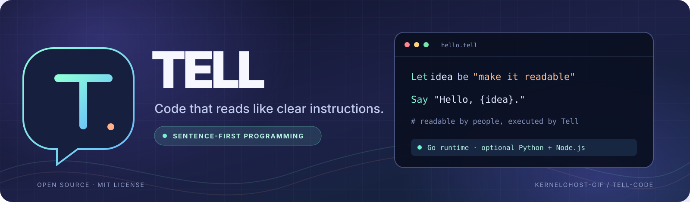

<div align="center">



<p><strong>A sentence-first programming language with a native Go runtime.</strong><br>
Write readable instructions. Run real programs.</p>

<p>
  <a href="https://github.com/KernelGhost-gif/Tell-Code/actions/workflows/native.yml"></a>
  <a href="LICENSE"></a>
  
  
</p>

<p>
  <a href="#quick-start">Quick start</a> ·
  <a href="#the-language">The language</a> ·
  <a href="#what-you-get">Features</a> ·
  <a href="#how-it-works">How it works</a> ·
  <a href="#documentation">Documentation</a> ·
  <a href="#contributing">Contributing</a>
</p>

</div>

---

## Code should explain itself

Tell is a programming language built around one simple idea: **make everyday code read more like clear instructions without giving up the structure of a real language.**

It has variables, functions, loops, collections, modules, errors, tests, a command-line interface and a native runtime. Its sentence-shaped syntax is defined and parsed—not guessed from free-form English.

```tell
Let developer be "Ada".
Let project be "something wonderful".

Say "Hello, {developer}."
Say "Let's build {project}."
```

```text
Hello, Ada.
Let's build something wonderful.
```

Tell is not an AI prompt interpreter, a pseudocode renderer, or a wrapper around Python. The primary runtime is a standalone Go executable.

## Why Tell?

- **Readable by design.** Statements such as `Let total be 0.` and `For each item in items:` put intent close to the code.
- **Still a programming language.** Functions, recursion, closures, collections, modules, classes, error handling and source diagnostics are part of the implementation.
- **Native execution.** Run ordinary Tell programs with a self-contained Go binary; Python is not needed for the core runtime.
- **More than one execution path.** Interpret source, compile a supported subset to portable bytecode, or experiment with a small native JIT tier.
- **Reuse existing ecosystems.** Optional Python and JavaScript bridges let Tell call functions from installed modules.

## Quick start

### 1. Get the native executable

Prebuilt Go runtime binaries are included for six OS/CPU combinations:

| Platform | Binary |
|---|---|
| Linux x86-64 | [tell-linux-amd64](releases/tell-linux-amd64) |
| Linux ARM64 | [tell-linux-arm64](releases/tell-linux-arm64) |
| macOS Intel | [tell-darwin-amd64](releases/tell-darwin-amd64) |
| macOS Apple Silicon | [tell-darwin-arm64](releases/tell-darwin-arm64) |
| Windows x86-64 | [tell-windows-amd64.exe](releases/tell-windows-amd64.exe) |
| Windows ARM64 | [tell-windows-arm64.exe](releases/tell-windows-arm64.exe) |

For example, download the Linux x86-64 binary:

```sh
curl -fL -o tell https://github.com/KernelGhost-gif/Tell-Code/raw/refs/heads/main/releases/tell-linux-amd64
chmod +x tell
./tell examples/hello.tell
```

On Windows, download [tell-windows-amd64.exe](releases/tell-windows-amd64.exe) and run:

```powershell
.\tell-windows-amd64.exe examples\hello.tell
```

The native executable does not need a separately installed Go or Python runtime. Python or Node.js is needed only when a program explicitly uses the corresponding interoperability bridge. Check the binary with `tell --version`. Verify downloaded files with the [SHA-256 checksums](releases/SHA256SUMS).

### 2. Try the CLI

```sh
tell examples/hello.tell          # run a program
tell check examples/features.tell # check without executing
tell repl                         # interactive shell
tell test examples                # run Tell source tests
tell format examples/hello.tell   # format a source file
tell --version                    # print the version
```

The native REPL keeps variables and functions between entries, accepts multiline blocks, prints `Say` output immediately, and remembers the latest bare expression result as `_`.

### 3. Make a project

```sh
tell new hello-world
tell run hello-world/main.tell
tell test hello-world
```

`tell new` and `tell init` create a small project scaffold with a manifest, entrypoint and smoke test. Dependency resolution and package installation are not implemented yet.

## The language

Tell keeps common operations approachable while allowing familiar symbols in expressions.

| Tell syntax | Meaning |
|---|---|
| `Let score be 10.` | Declare a variable |
| `Set score to score plus 5.` | Update a value |
| `Say "Hello".` | Print output |
| `If ready:` / `Otherwise:` | Branch |
| `For each item in items:` | Iterate |
| `Repeat 3 times:` | Repeat |
| `To greet(name):` | Define a function |
| `Give back value.` | Return |
| `Use the module "helpers.tell" as helpers.` | Import a local module |

Word operators and conventional operators can be used together:

| Tell | Equivalent |
|---|---|
| `a plus b` | `a + b` |
| `a times b` | `a * b` |
| `a divided by b` | `a / b` |
| `a is equal to b` | `a == b` |
| `a is at least b` | `a >= b` |
| `a and b` / `a or b` / `not a` | Boolean logic |

A slightly bigger example:

```tell
To average(values):
    Let total be 0.
    For each value in values:
        Set total to total plus value.
    End loop.
    Give back total divided by len(values).
End function.

Let scores be [12, 18, 24, 30].
Let result be the result of average with scores.
Say "Average score: {result}."
```

Explore [more examples](examples/) or read the [language specification](docs/LANGUAGE_SPECIFICATION.md) for the exact grammar and implemented behavior.

## What you get

| Area | Available today |
|---|---|
| Core language | Variables, expressions, branches, loops, functions, recursion, closures and collections |
| Data structures | Lists, tuples, sets, dictionaries, slicing and multiple assignment |
| Objects | Constructors, fields, instance methods, single inheritance and overrides |
| Modules | Relative local `.tell` imports with public exports and import caching |
| Errors and tests | `Try` / `Raise`, source diagnostics, `Check that` and a Tell source-test runner |
| Standard library | Math, random, statistics, JSON, date/time and CSV APIs, with runtime-specific differences |
| CLI | Run, check, format, test, REPL, project scaffolding and bytecode build |
| Type checks | Optional conservative checks for statically knowable declarations and values |

See [Collections](docs/COLLECTIONS.md), [Objects and Classes](docs/OBJECTS_AND_CLASSES.md), and the [Standard Library](docs/STANDARD_LIBRARY.md) for details.

## How it works

The Go runtime is the primary implementation. The execution options are deliberately different:

| Path | What it does | Current boundary |
|---|---|---|
| Interpreter | Executes Tell source directly | Default and broadest Go-runtime path |
| AOT bytecode | Compiles a supported subset into versioned `.tbc` files | Runs on the Go VM; not a standalone native executable |
| Native JIT | Compiles eligible hot typed numeric functions | Initial Linux x86-64 subset; unsupported functions fall back |

Try the experimental JIT path with the included typed example:

```sh
tell --typed --engine jit native/examples/jit-numeric.tell
tell --typed --engine auto --jit-threshold 24 --jit-stats native/examples/jit-numeric.tell
```

The first JIT backend is intentionally narrow: it targets eligible straight-line numeric functions with explicit `number` or `decimal` signatures. It does not compile arbitrary Tell programs. The [execution-engine guide](docs/EXECUTION_ENGINES.md) describes the supported operations, fallback rules and benchmark limits.

### Optional Python and JavaScript bridges

Tell can call public functions from installed Python and Node.js modules:

```tell
Use the Python library called statistics as stats.
Say stats.mean([12, 18, 24, 30]).

Use the JavaScript library called node:path as paths.
Say paths.basename("/projects/tell/main.tell").
```

The host runtimes and packages must already be installed. Calls cross a JSON boundary and execute in separate processes. This is interoperability—not a universal foreign-language runtime. See [Interoperability](docs/INTEROPERABILITY.md).

## The wider Tell toolchain

The repository contains several related projects. They have different maturity levels and language boundaries.

### Tell — native Go runtime

The recommended way to run and develop ordinary Tell programs. It contains the parser, interpreter, CLI, REPL, bytecode compiler/VM and initial JIT tier.

### TellC — experimental LLVM compiler

TellC is a separate C++17 compiler for a strongly typed Tell dialect. It generates LLVM IR and can produce native executables; supported configurations also provide JIT execution. Its syntax and type model are distinct from the Go runtime's dynamic language. Programs are not automatically interchangeable.

TellC can call compatible prebuilt C/C++ libraries through C-ABI wrappers. It does not compile arbitrary C++ source or expose C++ classes and templates directly. See [TellC](TellC/README.md) and its [build guide](TellC/docs/BUILDING.md).

### Tell Studio — early desktop editor

Tell Studio is a Rust/GPUI editor foundation. It currently opens one Tell file, supports basic editing and saving, and runs the file through the native Go CLI. Multi-tab projects, syntax highlighting, diagnostics, undo/redo, LSP integration and debugging remain future work. See [Tell Studio](studio/README.md).

### Legacy Python runtime

The Python implementation remains as a deprecated compatibility path. New language features target the Go runtime.

## Examples worth opening

| Example | Demonstrates |
|---|---|
| [hello.tell](examples/hello.tell) | Minimal program |
| [language-core.tell](examples/language-core.tell) | Core syntax |
| [features.tell](examples/features.tell) | Functions, loops, decisions and math |
| [factorial.tell](examples/factorial.tell) | Recursion |
| [guessing_game.tell](examples/guessing_game.tell) | Interactive input |
| [sets.tell](examples/sets.tell) and [tuples.tell](examples/tuples.tell) | Collections |
| [modules.tell](examples/modules.tell) | Local modules |
| [python_interop.tell](examples/python_interop.tell) and [javascript_interop.tell](examples/javascript_interop.tell) | Foreign-language bridges |
| [native-typed.tell](native/examples/native-typed.tell) | Typed Go dialect |
| [jit-numeric.tell](native/examples/jit-numeric.tell) | JIT-eligible numeric function |

## Documentation

| Guide | Description |
|---|---|
| [Language specification](docs/LANGUAGE_SPECIFICATION.md) | Grammar and portable core |
| [Typed Tell](docs/TYPED_TELL.md) | Opt-in typed dialect on the Go runtime |
| [CLI reference](docs/CLI_REFERENCE.md) | Commands, flags and REPL |
| [Execution engines](docs/EXECUTION_ENGINES.md) | Interpreter, bytecode VM and JIT |
| [Collections](docs/COLLECTIONS.md) | Collection operations and semantics |
| [Standard library](docs/STANDARD_LIBRARY.md) | Built-in modules and APIs |
| [Modules](docs/MODULES.md) | Local module imports and exports |
| [Interoperability](docs/INTEROPERABILITY.md) | Python and Node.js bridges |
| [Objects and classes](docs/OBJECTS_AND_CLASSES.md) | Implemented object model |
| [Architecture](docs/ARCHITECTURE.md) | Runtime design and boundaries |
| [Security](docs/SECURITY.md) | Execution effects and limitations |
| [Engineering audit](docs/ENGINEERING_AUDIT.md) | Verified gaps and engineering notes |

## Build and test

Install Go 1.22 or newer to build the native runtime:

```sh
cd native
go test ./...
go vet ./...
go build -o tell ./cmd/tell
./tell ../examples/hello.tell
```

From the repository root, cross-build the six Go binaries:

```sh
./scripts/build-all.sh
```

The script uses `CGO_ENABLED=0` and writes Linux, macOS and Windows amd64/arm64 binaries, checksums, an SPDX software bill of materials and third-party notices to `releases/`.

Run the broader test suites:

```sh
# Go runtime
cd native && go test ./... && go test -race ./... && go vet ./...

# Python compatibility runtime and project tests
cd .. && python -m unittest discover -s tests -v

# Tell source-level tests
./releases/tell-linux-amd64 test examples
```

## Project status

Tell is actively evolving. The current focus is improving grammar and cross-runtime conformance, expanding the bytecode VM, growing the JIT's supported subset, and developing TellC and Tell Studio.

A few things are **not** implemented yet: there is no package manager, dependency resolver, debugger or complete language server. The native bytecode compiler supports a documented subset, and the JIT supports only a narrow numeric subset. The Python runtime is deprecated. The [engineering audit](docs/ENGINEERING_AUDIT.md) tracks known gaps.

Tell is an interpreter, **not a sandbox**. Programs and foreign modules run with the permissions of the user who launches them. Do not execute untrusted code as if it were isolated; read the [security notes](docs/SECURITY.md).

## Contributing

Language ideas, examples, bug reports, documentation improvements and code contributions are welcome.

1. Read the [language specification](docs/LANGUAGE_SPECIFICATION.md) before changing syntax.
2. Check the [engineering audit](docs/ENGINEERING_AUDIT.md) for known limitations.
3. Add tests for behavior changes and run the relevant Go and Python suites.
4. Keep experimental features and unsupported syntax clearly identified.

Open an [issue](https://github.com/KernelGhost-gif/Tell-Code/issues) or submit a [pull request](https://github.com/KernelGhost-gif/Tell-Code/pulls).

---

<div align="center">

**Like the idea? Explore the code, try a program, and tell us what you think.**

<a href="https://github.com/KernelGhost-gif/Tell-Code">
  
</a>
<a href="https://github.com/KernelGhost-gif/Tell-Code/stargazers">
  
</a>

</div>

## License

Tell is released under the [MIT License](LICENSE).
